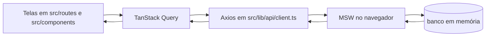
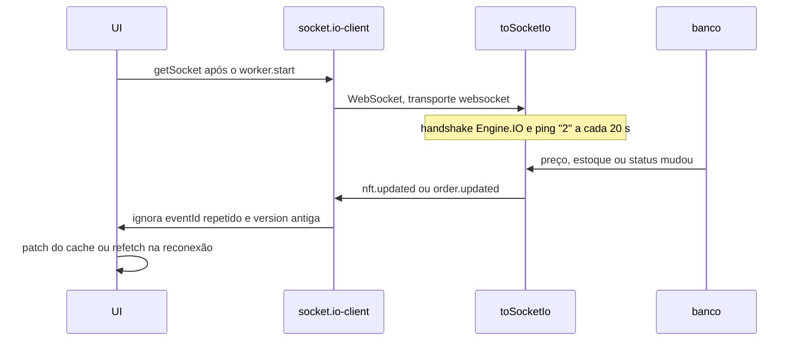

# Arquitetura

Kurio é um SPA Vite. A UI não contém respostas fictícias: tudo que parece dado de negócio passa por Axios e volta do MSW, ou chega pelo `socket.io-client`.

## Pastas

```
src/
  routes/            rotas de arquivo do TanStack Router
  components/        telas e layout; ui/ são os primitivos shadcn
  contracts/         schemas Zod compartilhados pelo cliente e pelo mock
  lib/api/           Axios e funções REST
  lib/               query client, chaves, dinheiro, sessão, guarda de rota
  realtime/          socket.io-client, deduplicação e patch do cache
  mocks/             banco em memória, handlers REST e Socket.IO
e2e/                 Playwright
public/              mockServiceWorker.js
```

O plugin do Router gera [`src/routeTree.gen.ts`](src/routeTree.gen.ts) no `dev` e no `build`. Esse arquivo entra no git para o `tsc` rodar sem o Vite.

## Fluxo de dados



1. A rota valida a busca com Zod e monta a chave em [`src/lib/query-keys.ts`](src/lib/query-keys.ts).
2. O `queryFn` chama uma função em [`src/lib/api`](src/lib/api).
3. O interceptor de request coloca `X-Guest-Id` e, se houver token, `Authorization: Bearer`.
4. O interceptor de response transforma falhas no envelope tipado `ApiError` ([`src/lib/api/errors.ts`](src/lib/api/errors.ts)). `invalid_session` apaga o token.
5. A função REST faz `schema.parse` na resposta. O mock valida o corpo com o mesmo schema.

Cancelamento: a listagem e o detalhe recebem o `AbortSignal` da Query. Trocar filtro troca a chave, e o request anterior é abortado. Resposta 4xx não faz retry. Rede e 5xx tentam mais uma vez. Mutações não repetem sozinhas. `staleTime` é 15 s e não há refetch ao focar a janela, para um patch de socket não ser mascarado por um reload.

## Isolamento

A sessão fica em `localStorage` (`nft-market:token`, `nft-market:user-id`). O id entra na chave da Query. Visitante usa o segmento `anon`, exceto o carrinho, cuja chave é `guest:<uuid>` ou `user:<id>`.

Trocar de conta muda o id e portanto a chave. Logout chama a API e, no `finally`, apaga o token. Um 401 faz o mesmo e remove as queries que não são catálogo público. O pedido do socket só altera o cache se `event.userId` for o usuário da sessão.

Checkout, perfil, carteiras e pedido usam `requireSession` em [`src/lib/auth.ts`](src/lib/auth.ts) e mandam para `/login?redirect=`. O redirect só aceita caminho que começa com `/` e não com `//`.

## Tempo real



O cliente só é importado dentro de `getSocket()`, depois de `worker.start()` em [`src/main.tsx`](src/main.tsx). O `socket.io-client` guarda o construtor `WebSocket` na avaliação do módulo; se carregar antes do MSW, a interceptação não acontece.

Cada evento traz `eventId`, o id do recurso e `version`. [`src/realtime/bridge.tsx`](src/realtime/bridge.tsx) guarda os últimos `eventId`s (teto de 200). [`src/realtime/apply-events.ts`](src/realtime/apply-events.ts) ignora `version` menor ou igual à do cache. `nft.updated` reescreve lista, detalhe e itens do carrinho e, se o preço mudou, invalida cotações. `order.updated` só mexe no pedido daquele `userId`. Na segunda conexão em diante, lista, detalhe, carrinho, cotação e pedido são buscados de novo na REST. A primeira conexão não dispara esse refetch.

O checkout exige um checkbox com o `totalEth` atual. Se a cotação mudar, a confirmação deixa de valer e o botão de compra desliga. Favoritar é a mutação otimista: o cache muda antes da resposta e volta ao anterior se a API falhar.

## Dinheiro e contratos

ETH não trafega como `number`. [`src/lib/money.ts`](src/lib/money.ts) usa `decimal.js` com precisão 40 e meio para cima, e devolve string com no máximo 18 casas, sem zeros à direita. `formatEth` mostra até 4 casas. Quantidade é inteira.

Os schemas ficam em [`src/contracts`](src/contracts). O envelope de erro é `{ error: { code, message, details, requestId } }`.

| Código                  | HTTP                                                |
| ----------------------- | --------------------------------------------------- |
| `validation`            | 422                                                 |
| `invalid_session`       | 401                                                 |
| `forbidden`             | 403                                                 |
| `not_found`             | 404                                                 |
| `availability_conflict` | 409                                                 |
| `conflict`              | 409                                                 |
| `transient`             | 503, ou status 0 se a rede caiu ou estourou o tempo |

`POST /api/orders` exige `Idempotency-Key`. A mesma chave e o mesmo corpo canônico devolvem o mesmo pedido. A mesma chave com outro corpo devolve 409. O recibo é cópia dos valores no momento da criação. A chave da tentativa fica em `sessionStorage` (`nft-market:order-key`) para um segundo clique reutilizar a mesma operação.
